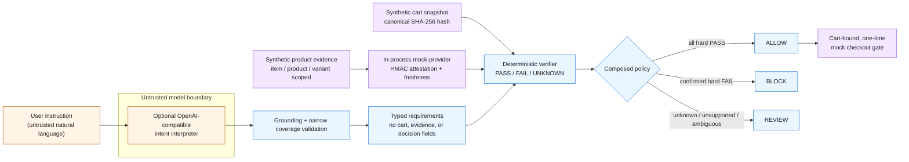

# BuyRightAgents

**A semantic verification boundary for AI shopping agents.**

An agent can stay within a spending limit and still buy the wrong thing. A ₹4,500
leather backpack is within a ₹5,000 allowance—but it violates a request for a
vegan backpack. BuyRightAgents is a Go CLI prototype that independently checks a
proposed cart against the user's requirements before a **mock** checkout can be
authorized.

> **An agent may propose a cart; only evidence bound to that cart may authorize it.**

It implements an optional LLM intent interpreter, strict validation of its typed
output, cart- and item-scoped evidence evaluation, deterministic `ALLOW` /
`BLOCK` / `REVIEW` decisions, and a cart-bound, one-time mock checkout gate.
The interpreter is never the authority that approves its own purchase.

This is an independent prototype. Carts, evidence, attestations, and checkout are
synthetic; it does not contact merchants, authenticate seller claims, or execute
payments.

## In 15 seconds

| Question | Answer |
| --- | --- |
| **What problem?** | Delegated payment permission does not establish that a selected cart satisfies the user's semantic constraints. |
| **Why now?** | Agentic and delegated payment flows increase the need to distinguish “may spend” from “selected the right purchase.” |
| **What is distinctive?** | An LLM may translate language into data; a deterministic verifier evaluates independently supplied, cart-bound evidence. |
| **What actually runs?** | A Go CLI, strict typed schemas, canonical cart hashing, HMAC-attested *mock* evidence, an in-memory mock gate, and offline evaluation suites. |

## The gap: permission is not purchase correctness

Imagine a user asks for a **vegan backpack that fits a 16-inch laptop, costs less
than ₹5,000 including delivery, and arrives before Friday**. A shopping agent
proposes a cart. A spending cap can decide whether the charge is within budget;
it cannot prove that the selected item is vegan, that evidence belongs to the
selected variant, or that the delivery promise remains valid after the cart
changes.

## Complementing AP2 and UCP

[AP2](https://github.com/google-agentic-commerce/AP2/blob/main/docs/ap2/specification.md)
defines cryptographically verifiable checkout and payment mandates, including
constraints that bind an agent-authorized transaction to user intent. The
[Universal Commerce Protocol (UCP)](https://ucp.dev/specification/overview/)
standardizes interoperable commerce interactions among platforms, businesses,
and payment handlers. Both are important foundations—not systems this project
tries to replace.

BuyRightAgents explores a narrower, complementary question: **can an
independent verifier establish that the available evidence supports the user's
requirements for the exact cart and product variant proposed for checkout?**

| Concern | AP2 / UCP role | What this prototype implements |
| --- | --- | --- |
| Agent identity | Protocol identity and authorization mechanisms | Not implemented. |
| Permission to transact | AP2 mandates and payment authorization flows | Mock-only, one-time local gate; no payment credential. |
| Natural-language intent | A shopping agent determines task details before mandate assembly | Optional untrusted LLM extraction with grounded validation. |
| Product evidence and claim verification | Commerce participants expose interoperable capabilities and data | Synthetic, item/product/variant-scoped evidence only. |
| Cart-bound checkout authorization | Checkout/payment binding and commerce flows | Canonical cart hash plus a mock, HMAC-attested evidence gate. |

AP2 leaves task interpretation to the shopping agent and explicitly places
commerce-protocol details such as catalogue APIs and checkout updates outside
its scope. This prototype does not establish merchant truth; it makes the
evidence, scope, and cart binding needed for a deterministic local decision
visible and testable.

The same distinction is relevant to delegated-payment initiatives such as
[NPCI's UPI Circle Full Delegation announcement](https://www.npci.org.in/uploads/NBSL_Press_release_BHIM_Goes_Live_with_UPI_Circle_Full_Delegation_Enabling_Authorised_UPI_Payments_within_set_limits_7b308e643d.pdf),
which describes authorization within a monetary limit. BuyRightAgents explores
the separate question:

> Does this exact proposed cart still satisfy the user's original request?

That matters for user trust, unwanted purchases, returns and disputes, and the
safe adoption of autonomous buying flows. Those are potential product impacts,
not results measured by this repository.

## What runs and where trust stops



The model output is strict-decoded as untrusted data. It cannot supply a cart,
evidence, a decision, or checkout authority. The verifier evaluates typed
requirements only after validation; the mock gate independently re-evaluates a
fully bound context. A hash binds a report to a supplied snapshot, while the
mock attestation binds synthetic evidence to that snapshot. Neither proves a
real merchant's claim or live cart.

For a code-level map, see [Architecture](docs/ARCHITECTURE.md) and the
[proof guide](docs/PROOF.md).

## Try the verifier in 60 seconds—no key or network needed

Requires Go 1.22+; the module has no third-party dependencies.

```sh
git clone https://github.com/BHAVIKA44/buyrightagents.git
cd buyrightagents
make demo
```

`make demo` evaluates these real checked-in fixtures through the same local
verification package and formats the resulting reports. It checks each expected
decision and exits nonzero if a fixture changes unexpectedly:

| Scenario | User intent represented in the fixture | Evidence / cart fact | Actual deterministic result | Why it matters |
| --- | --- | --- | --- | --- |
| [ALLOW](examples/vegan-backpack.json) | vegan, 16-inch fit, total ≤ ₹5,000, arrival by 2026-10-30 | selected item is vegan and fits 16 inches; derived total is ₹4,750; promised date is 2026-10-29 | `ALLOW` | Evidence supports every hard requirement. |
| [BLOCK](examples/non-vegan-backpack.json) | vegan | selected item has accepted `vegan: false` evidence | `BLOCK` | A known hard violation cannot be paid through merely because the cart is otherwise plausible. |
| [REVIEW](examples/missing-vegan-evidence.json) | vegan | no product evidence establishes the claim | `REVIEW` | Missing proof is not treated as a pass. |

The demo prints each cart total, actual decision, and the hard requirement that
passed, failed, or remained unresolved. Full JSON reports—with the canonical
cart hash, evidence provenance, and per-requirement outcomes—remain available:

```text
# vegan-backpack.json
"decision": "ALLOW"       "outcome": "PASS"

# non-vegan-backpack.json
"decision": "BLOCK"       "outcome": "FAIL"

# missing-vegan-evidence.json
"decision": "REVIEW"      "outcome": "UNKNOWN"
```

The fixtures are synthetic and offline. They demonstrate the verifier's policy,
not proof of a real catalogue claim. The regression test
[`TestRunVerify`](cmd/buyrightagents/main_test.go) executes all three through the
public CLI path; [`TestRunDemoUsesActualFixtureResults`](cmd/buyrightagents/main_test.go)
checks the formatted path.

`make demo` runs **verification only**. It does not interpret natural language,
issue HMAC attestations, or attempt a mock checkout. The separate mock gate
tests in [the proof guide](docs/PROOF.md) exercise cart mutation, stale or
mismatched evidence, and one-time approval replay.

## The engineering choices

| Failure mode | Design and implementation | Prototype guarantee | Deliberate limit |
| --- | --- | --- | --- |
| The model invents fields or authorizes itself. | [`internal/intent/interpreter.go`](internal/intent/interpreter.go) strict-decodes a constrained schema that has requirements, clarifications, and unsupported constraints—never a decision or cart. [`TestModelJSONRejectsMalformedUnknownDuplicateAndDecisionFields`](internal/intent/interpreter_test.go) covers unsafe output. | Invalid model output does not become an approval. | Schema validity is not semantic completeness. |
| A hard requirement disappears or changes polarity. | Grounded source spans and targeted, position-aware coverage checks in [`internal/intent/coverage.go`](internal/intent/coverage.go); tests include [`TestCoverageGuardDetectsOmittedCategoryMaterialAndLaptopFit`](internal/intent/interpreter_test.go) and [`TestWrongPolarityCannotBypassCoverageThroughIncidentalText`](cmd/buyrightagents/purchase_check_test.go). | Defined, recognizable omissions become `REVIEW` rather than silent authorization. | This is not general natural-language understanding. |
| `under ₹5,000` quietly becomes inclusive, or a date uses a number operator. | Typed values and attribute/operator contracts in [`internal/verification/verification.go`](internal/verification/verification.go); [`TestStrictNumericBoundaries`](internal/verification/verification_test.go) and [`TestBuiltInCartRequirementContracts`](internal/verification/verification_test.go). | Exact numeric comparisons; strict and inclusive bounds remain distinct; invalid combinations are errors. | Only implemented attributes/operators are understood. |
| Evidence for one listing approves another. | Item evidence must agree with cart item, product, and variant; multi-item requirements need explicit bindings. See [`TestEvidenceScopePreventsCrossItemMatching`](internal/verification/verification_test.go) and [`TestPurchaseCheckMultiItemBindingPolicy`](cmd/buyrightagents/purchase_check_test.go). | Wrong-item, wrong-product, or wrong-variant evidence cannot satisfy an item requirement. | Evidence itself is synthetic unless the mock gate validates an attestation. |
| A product claim overrides a changed price or delivery promise. | `total_price_paise` and `delivery_date` are derived only from the validated cart snapshot. [`TestSnapshotDerivedTotalAndDelivery`](internal/verification/verification_test.go) covers this boundary. | Product evidence cannot override cart-derived facts. | The supplied cart is not a merchant-authenticated live cart. |
| An approval outlives or drifts from its cart. | Canonical cart hashing, context binding, in-process HMAC attestations, a gate-owned clock, and one-time approvals in [`internal/evidence/mock_provider.go`](internal/evidence/mock_provider.go) and [`internal/checkout/control.go`](internal/checkout/control.go). [`TestGateAuthorizesOneTimeBoundCheckout`](internal/checkout/control_test.go), [`TestGateRechecksEvidenceFreshnessAtCheckout`](internal/checkout/control_test.go), and [`TestGateRejectsTamperingWithoutConsumingApproval`](internal/checkout/control_test.go) exercise the path. | The mock gate rejects altered, stale, mismatched, or replayed approved contexts. | It is process-local and does not authenticate a seller or execute payment. |
| One confirmed hard failure is hidden by another unknown. | The composed purchase policy gives independently established hard `FAIL` precedence over unrelated unknowns; [`TestPurchaseCheckHardFailureDecisionPrecedence`](cmd/buyrightagents/purchase_check_test.go) covers it. | A known applicable hard failure is `BLOCK`, not silently downgraded to `REVIEW`. | Contradictory or ambiguous intent without an independent failure remains `REVIEW`. |

The verifier's rule is intentionally simple:

```text
any independently established hard FAIL         -> BLOCK
no hard FAIL, any unresolved hard requirement  -> REVIEW
all hard requirements PASS, no unresolved intent -> ALLOW
preferences alone do not cause BLOCK
```

## Evidence, not just claims

The project keeps deterministic, adversarial, live-model, and historical results
separate because they answer different questions.

| Evidence set | Reproduce | Reported result | What it can show | What it cannot show |
| --- | --- | --- | --- | --- |
| Deterministic verifier corpus | `make eval` | **67/67** decision matches; **88/88** requirement-outcome matches | Agreement with independently authored synthetic verifier labels | Real seller truth, live-cart integrity, or production safety |
| Adversarial mock-path corpus | `make adversarial-eval` | **109/109** scenarios; **0** unexpected `ALLOW`; **0** unauthorized mock checkouts | Resistance to the fixed malformed/tampered/cross-item/stale/replay fixtures | Zero vulnerabilities outside this corpus or live-model robustness |
| Controlled live model run | [report](docs/LIVE_GROQ_E2E_EVALUATION.md) | **18/18** synthetic cases; **36** calls; **15** `ALLOW`; **3** `REVIEW`; **15** mock checkouts | One recorded buyer + interpreter run against a frozen synthetic corpus | A benchmark or stable model behavior |
| Saved-Groq checkout replay | [report](docs/LIVE_GROQ_CHECKOUT_EVALUATION.md) | **48** saved outputs replayed; **2** invalid safely rejected; **60** scenarios; **0** unauthorized mock checkouts | Current handling of retained model outputs through the mock checkout path | Public reproducibility—the checkpoint is private—or live seller truth |

The adversarial suite includes wrong-product/variant evidence, missing evidence,
strict price boundaries, cart mutation, malformed model output, untrusted
evidence, tampered approvals, and replay attempts. It intentionally reports
unfavourable outcomes too: recognized model omissions become `REVIEW`; one
frozen live-E2E oracle classified a leather backpack as unacceptable even though
it matched the written constraints; and safe `REVIEW` decisions can be
unnecessary refusals of compliant synthetic carts. Details and command mapping
are in [docs/PROOF.md](docs/PROOF.md).

## Developer workflow

```sh
go run ./cmd/buyrightagents help
go run ./cmd/buyrightagents version

go test -count=1 ./...
go test -race -count=1 ./...
go vet ./...
go build ./...
make eval
make adversarial-eval
```

`make adversarial-eval` regenerates its checked-in synthetic report and JSON
result. It does not call an LLM. The CI workflow runs the same offline quality
gates on pushes and pull requests; see [`.github/workflows/ci.yml`](.github/workflows/ci.yml).

### Optional remote interpretation

Remote interpretation is explicitly opt-in and never authorizes checkout by
itself. Provide an OpenAI-compatible endpoint and your own key locally:

```sh
export BUYRIGHTAGENTS_LLM_API_KEY="..."
export BUYRIGHTAGENTS_LLM_BASE_URL="https://api.groq.com/openai/v1"
export BUYRIGHTAGENTS_LLM_MODEL="openai/gpt-oss-120b"

go run ./cmd/buyrightagents interpret \
  --reference-time "2026-10-28T16:48:00+05:30" \
  "Find a vegan bag under ₹5,000 and ideally red."
```

`interpret` returns validated *intent data*, not a decision. `check`,
`mock-checkout`, and `eval-intent` also make remote requests when configured;
`eval-intent` may incur charges. Do not log, commit, or share keys. The core
offline walkthrough does not need a key or network.

## Prototype boundaries

- **No merchant or payment integration.** There is no real checkout, payment
  authorization, seller authentication, or live-cart retrieval.
- **Synthetic evidence only.** An HMAC proves that this prototype's mock provider
  attested a particular synthetic record; it does not prove external seller truth.
- **Interpretation is incomplete by design.** Grounding and coverage checks catch
  defined error classes, not every omission or nuanced linguistic meaning.
- **`REVIEW` is a safety outcome, not a success.** It withholds mock authorization
  when hard intent or evidence is unresolved, and can inconvenience a compliant
  purchase.
- **The gate is a local demonstration.** Approvals are in-memory, process-local,
  cart-bound, and one-time; they are not deployable payment credentials.

Read [the problem statement](docs/PROBLEM.md), [Architecture](docs/ARCHITECTURE.md),
[engineering decisions](docs/DECISIONS.md), and the [claim-to-proof guide](docs/PROOF.md)
for the five-minute review route.

## Where it could go next

1. **Authenticated merchant evidence adapters** with explicit provenance and
   freshness semantics, rather than synthetic claims.
2. **A persistent authorization service** that revalidates a merchant's live cart
   at checkout while preserving the same binding and audit invariants.
3. **Broader, independently reviewed language and evidence evaluation**, with
   measured false-approval and false-refusal rates across representative tasks.

Those are future product steps—not capabilities claimed by this repository.
